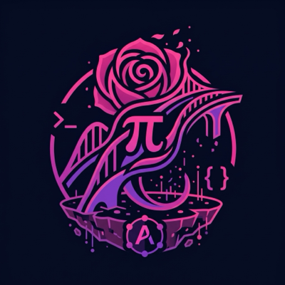

<p align="center">
  
</p>

<h1 align="center">Antigravity Bridge</h1>

<p align="center">
  <b>Google Antigravity as a Pi model provider.</b><br>
  Gemini 4 Argon, Gemini 4 Hydrogen, Gemini 3.8 Flash, Claude Sonnet 5.5 and
  Claude Opus 5.5 on the subscription you already pay for.
</p>

<p align="center">
  <a href="https://www.npmjs.com/package/@3d24rd0/pi-antigravity-bridge"></a>
  <a href="LICENSE"></a>
  <a href="https://pi.dev/packages/@3d24rd0/pi-antigravity-bridge"></a>
</p>

<p align="center">
  <a href="https://github.com/Gentleman-Programming/gentle-ai"></a>
</p>

---

## What it does

Pi speaks to models. Antigravity only speaks through its own CLI and its own
protocol. This package puts a provider in between:

```
   Pi  ──▶  Antigravity Bridge  ──▶  agy CLI  /  ACP server  ──▶  Google
             │
             └──◀ Pi's tools, served over a localhost MCP bridge
```

- **Two engines, chosen by the model name.** `-acp` drives Google's official ACP
  server (images, native diff cards); `-cli` drives the stream-json `agy` CLI.
- **Pi's tools work.** The model reads files, edits, runs commands and delegates
  to subagents through a localhost bridge — with real Pi cards, not text dumps.
- **No API key.** It rides the Antigravity CLI and server you already signed
  into. No per-token billing, no key to paste.

## Install

**Pi**

```bash
pi install npm:@3d24rd0/pi-antigravity-bridge
```

**Gentle Shell**

```bash
gentle-shell install npm:@3d24rd0/pi-antigravity-bridge
```

Then restart. `/agy` joins the command list and `antigravity/` models appear in
`/model`.

<details>
<summary>Install from git instead, or by hand</summary>

```bash
pi install git:github.com/3d24rd0/antigravity-bridge
```

By hand, in `~/.pi/agent/settings.json` (Gentle Shell:
`~/.gentle-shell/agent/settings.json`):

```json
{ "packages": ["git:github.com/3d24rd0/antigravity-bridge"] }
```

</details>

## Use it

**1. Pick a model.** `/model` → anything under `antigravity/`. The suffix picks
the engine; Pi's thinking toggle picks the reasoning level.

| Model | Engine | Input | Best for |
|---|---|---|---|
| `antigravity/gemini-4-argon-acp` | ACP | text + image | Deep reasoning, native diff cards |
| `antigravity/gemini-4-hydrogen-acp` | ACP | text + image | Longest-horizon reasoning; the only model reaching `xhigh` |
| `antigravity/gemini-3-8-flash-acp` | ACP | text + image | Low latency, light quota use |
| `antigravity/gemini-4-argon-cli` | CLI | text + image | Same model, stream-json engine |
| `antigravity/gemini-3-8-flash-cli` | CLI | text + image | Fast execution |
| `antigravity/claude-sonnet-5-5-cli` | CLI | text + image | Balanced speed and quality |
| `antigravity/claude-opus-5-5-cli` | CLI | text + image | Advanced Claude reasoning |

Claude models are CLI-only: the ACP server rejects non-Gemini models. On the CLI engine the prompt carries text only, so an attached image is staged on disk and the model is pointed at it.

The thinking toggle offers exactly the tiers agy lists for the model you picked: `gemini-4-hydrogen` goes up to `xhigh`, `gemini-4-argon` stops at `high`, and a model agy lists with a single tier has no toggle at all. The list follows agy's catalog, so `agy update` shows up after the next model refresh instead of waiting for a reload.

**2. Check the wiring once.**

```bash
/agy doctor     # driver state, CLI and server versions, paths, effective config
/agy quota      # what your subscription has left
```

**3. Just talk.** Provider turns, Pi tools, subagents and review all work. The
first ACP turn downloads Google's server (~1.5 GB) and asks for a second Google
sign-in — one time only, and the `-cli` models skip it entirely.

## `/agy`

Bare `/agy` opens the settings menu. Every setting also exists as a subcommand,
and **Tab completes them**:

```
/agy  doctor  auth  auth-manual  quota  clear  patch-cleanup
      mode  readonly  permissions  timeout  ask  stop  web  bridge  tools
      digest  system-prompt  model  thinking  agent
      tasks  artifacts  subagents  acp-bin  acp-update
```

```bash
/agy mode accept-edits|plan      # plan is refused, not faked (see Safety)
/agy readonly on|off             # refuse every provider turn
/agy permissions on|off          # native agy tool auto-approval
/agy timeout <1-1440|off>        # overall turn cap
/agy bridge all|mcp|none         # which Pi tools the model can call
/agy stop [runId-prefix]         # stop a running background AskAntigravity run
/agy tasks [tail <id>]           # background task logs of this conversation
/agy artifacts [open <n|name>]   # files this conversation produced or received
```

### Background delegations

`AskAntigravity` is blocking by default. With `background: true` the call
returns a `bg_` run id at once and the detached `agy -p` keeps running: Esc does
not kill it, and when it settles the full answer arrives as one message marked
UNTRUSTED and carrying the `conversationId` resume handle. Up to four runs at a
time, one per conversation, and `/agy stop` ends one (no argument = the only
running one). A background run lives and dies with the Pi session: `/new`,
`/resume`, `/fork` and `/reload` kill it silently, and `print`/`json` mode
refuses it because the process exits before the answer could arrive.

Full reference, every flag and every environment variable:
**[docs/how-it-works.md](docs/how-it-works.md)**.

## Safety, up front

- **`agy` runs its own tool loop and is not prompted by Pi by default.** An
  Antigravity turn can execute commands and write files on this machine.
- **The approval gate is opt-in.** `AGY_APPROVALS=shadow` routes mutating native
  tools through Pi's permission flow; headless sessions deny.
- **Read-only is enforced, never promised.** Plan mode cannot be enforced
  upstream, so the bridge refuses provider turns instead of faking it. Use
  `/agy readonly on`, Pi's tool restrictions, or the gate.
- **Your credentials are never read.** Auth checks ask whether
  `acp_token.json` exists (`stat`, never opened) and whether `GEMINI_API_KEY` is
  set (a boolean, never the value). When an `agy` update rewrites `auth.type` to
  a method this machine cannot satisfy, the bridge restores `oauth-personal` in
  `~/.gemini/antigravity-acp/settings.json` — merging, so other keys survive —
  and says what it did. No credential file is opened, and nothing leaves the
  machine.

Details and threat model: [docs/how-it-works.md#safety](docs/how-it-works.md#safety).

## Requirements

| | |
|---|---|
| **Pi** | **1.5.0+** — the version this bridge is tested against; peers are declared `*` (`pi-coding-agent`, `pi-tui`, `pi-ai`, `typebox`) |
| **Node** | ≥ 22 |
| **Antigravity CLI** | `agy`, signed in once (required by the CLI engine and by `AskAntigravity`) |
| **Google account** | with Antigravity access; ACP additionally asks its own sign-in |

Gentle Shell bundles its own Pi. If `/model` shows no `antigravity/` models
after installing, check which Pi it runs and `gentle-shell upgrade` when that Pi
is older than 1.5.0.

## FAQ

**How do I see what quota is left?** `/agy quota`. Other Antigravity bridges
call it `/antigravity:usage`; here every engine-level question lives under the
one `/agy` command, so there is no second name to remember.

**Can different providers use different accounts?** Yes. Logins are per
provider: Codex can run on one email while Gemini runs on another, and neither
login disturbs the other. `agy` itself is the exception — it holds one active
Google account at a time, so switching it changes the account behind every
`antigravity/*` model.

**Can I install a second Antigravity bridge?** No. Packages such as
`pi-antigravity`, `@cortexkit/pi-antigravity-auth` or
`@estebanforge/pi-antigravity-bridge` register the same commands, the same
`antigravity/` provider and the same `~/.gemini/antigravity-*` auth paths, so
they collide with this bridge. Keep exactly one installed.

## Development

```bash
git clone https://github.com/3d24rd0/antigravity-bridge
cd antigravity-bridge && npm install
npm run check      # tsc --noEmit + vitest
```

The package ships TypeScript and Pi loads it directly: no build step, so `src/`
is published as written. Pi finds the entry point through `pi.extensions` in
`package.json`.

## Acknowledgements

Based on the original extension by [@EstebanForge](https://github.com/EstebanForge).
Licensed under [MIT](LICENSE).
